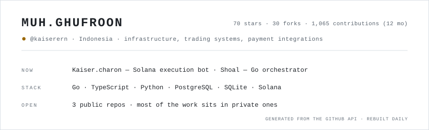

<picture>
  <source media="(prefers-color-scheme: dark)" srcset="assets/status-dark.svg">
  
</picture>

I build systems that are supposed to keep working when nobody is watching them.
Right now that means a Solana execution bot with real users, a container
orchestrator in Go, and bank payment integrations where one wrong byte is one
wrong balance.

Three repos are public. Everything else stays private — payment rails, internal
tooling, the Shoal platform. The numbers on the card are pulled from the API
every day, not typed in once.

## Running

### [Kaiser.charon](https://github.com/kaiserern/Kaiser.charon)

`JavaScript` · 70 stars · 29 forks · dry run by default

Telegram-driven pump.fun bot. Signals go through a route allowlist, get
enriched, scored, filtered, and only then become a position — with an LLM in
the loop only if you turn it on. Three modes: `dry_run`, `confirm`, `live`.
Paper fills use executable Jupiter quotes in both directions, so the PnL it
prints is the PnL execution would give you.

A fork of [yunus-0x/charon](https://github.com/yunus-0x/charon) — I kept
changing things while running it until the diff needed its own home. 29 offline
tests, no keys and no network required.

### [Shoal](https://github.com/Shoal-Technology/shoal)

`Go` · Apache-2.0 · org repo

Container orchestrator built on containerd: declarative workloads, an embedded
web portal, and no Kubernetes tax for a fleet that fits on one box.

### [radar-loker](https://github.com/kaiserern/radar-loker)

`Python` · live at [radarloker.my.id](https://radarloker.my.id)

Catches fake job-interview invitations before someone travels to the address on
them. Pattern detection on the letter itself, an open blacklist of 339 broker
("calo") storefront addresses with their fake company names, and SQLite FTS5 so
you can search by street or block. Text extraction runs in the browser.

## Stack

```text
orchestration   Go, containerd, Docker
product         TypeScript, React, Node, PostgreSQL
data & bots     Python, SQLite (WAL, FTS5), Solana web3, Jupiter
payments        SNAP-style signing, HMAC-SHA512, RSA callbacks, VA lifecycle
```

## How I work

- **Paper first.** No strategy number gets posted until it survives executable
  quotes and fees, not mark prices.
- **Tests offline.** Anything that touches a network gets a test double, so a
  red build means broken logic, not a bad RPC day.
- **The log wins.** When a live run loses money, the log says so in the same
  voice it says everything else.

---

[Kaiser.charon](https://github.com/kaiserern/Kaiser.charon) · [Shoal](https://github.com/Shoal-Technology) · [X](https://x.com/kaiserrern) · [radarloker.my.id](https://radarloker.my.id)
